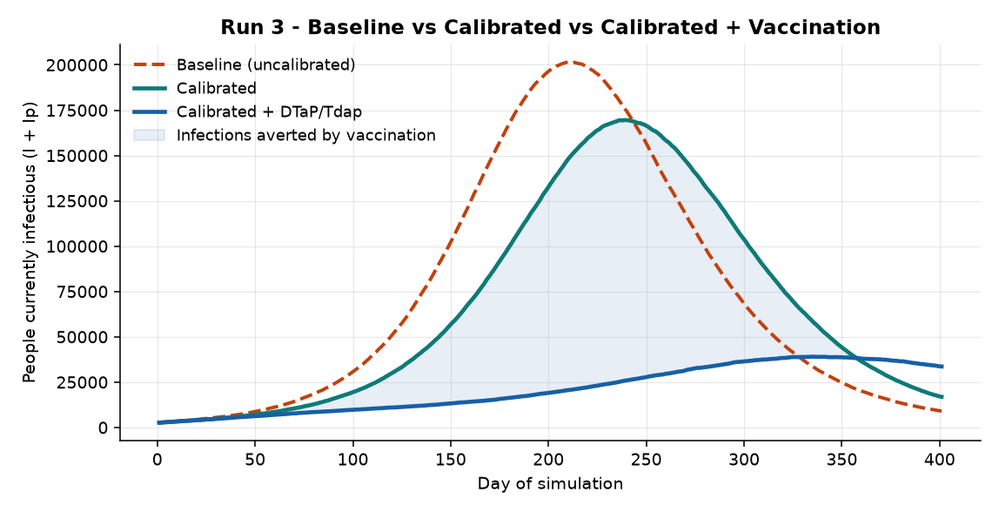
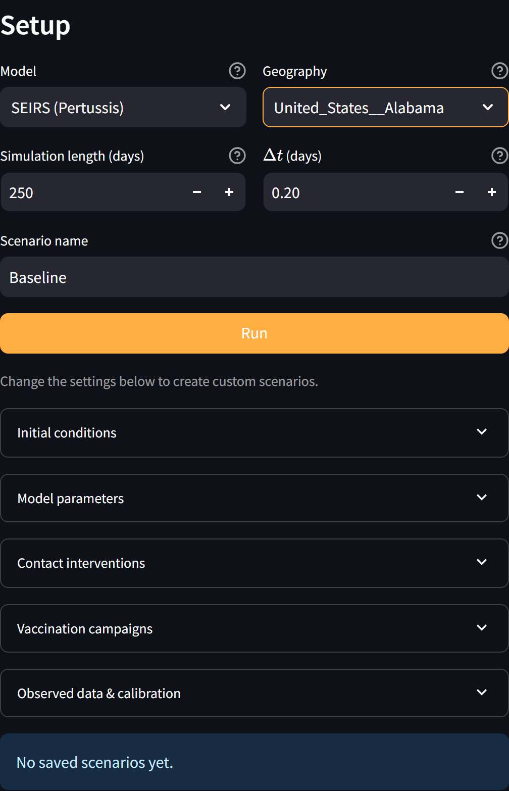
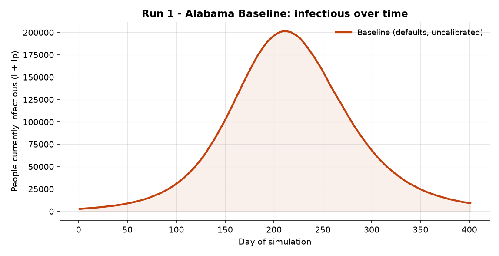
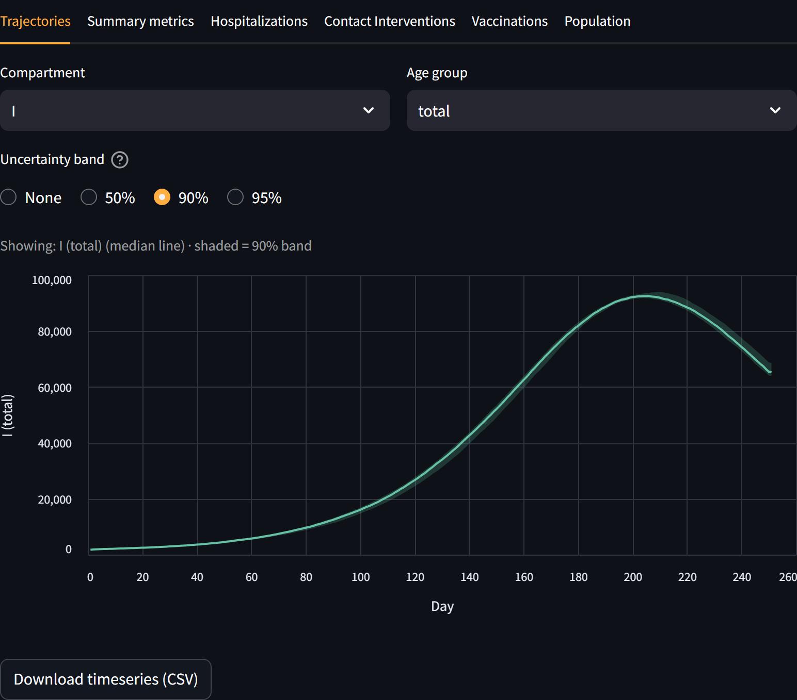
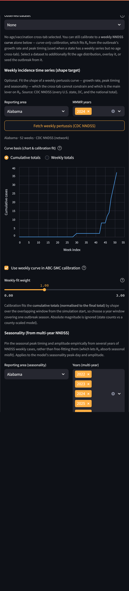
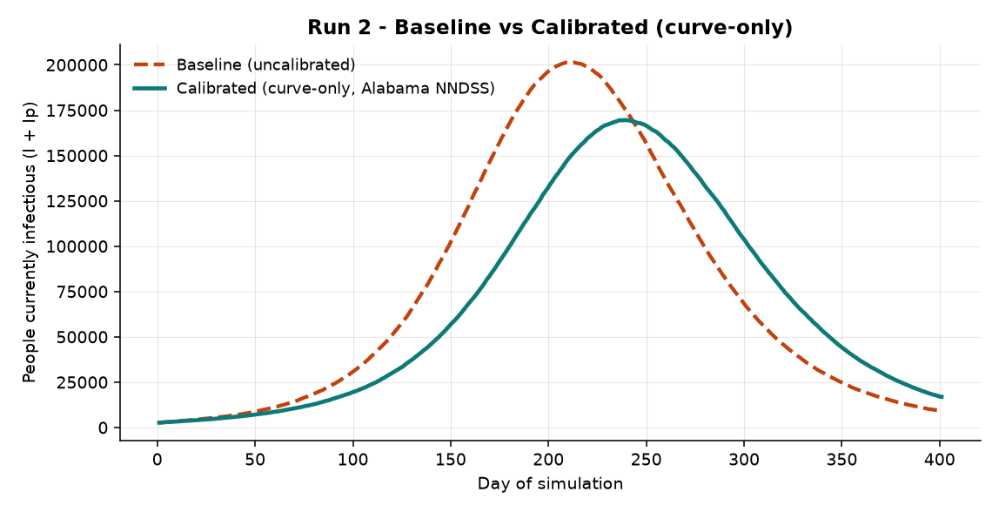
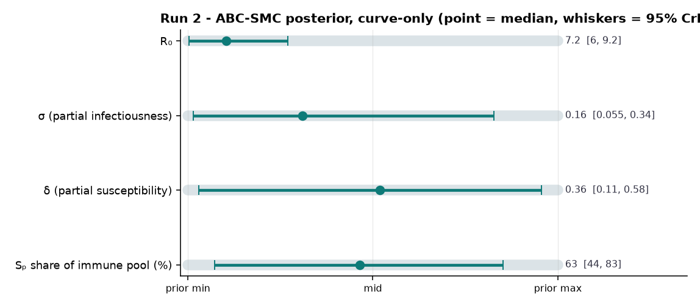
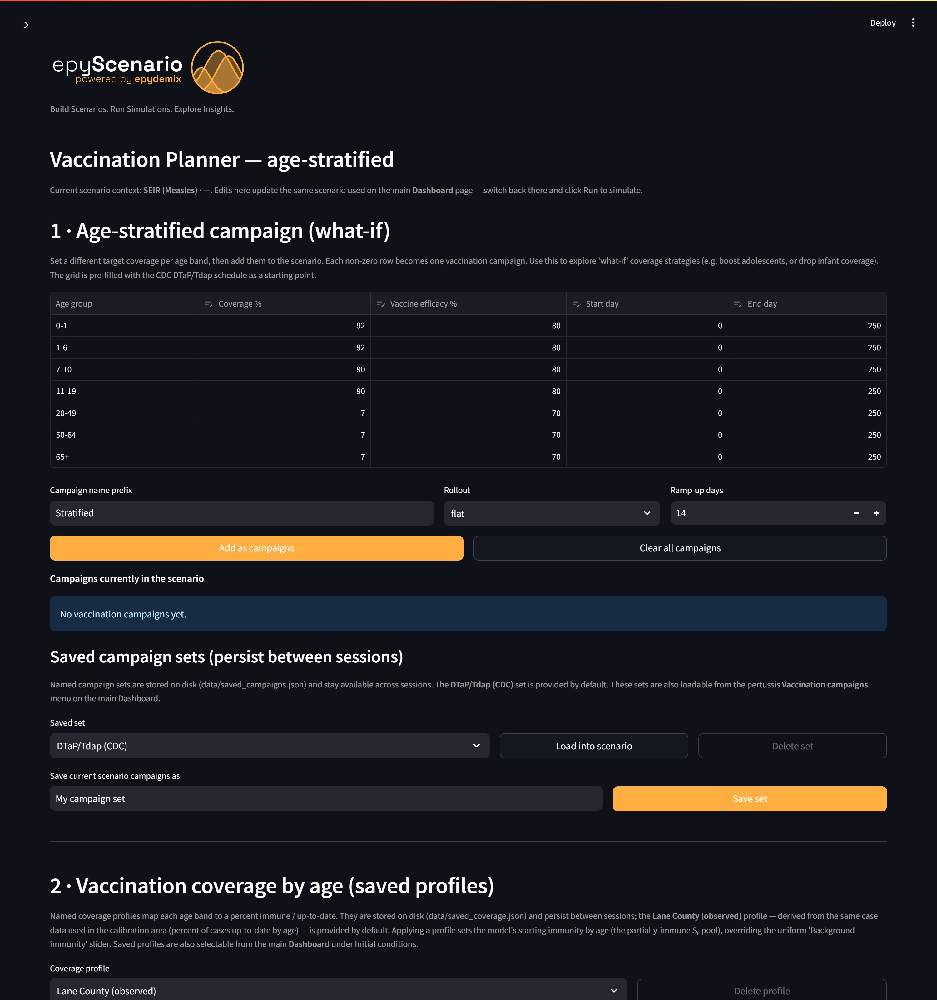

# EpyScenario User Manual — The Alabama Pertussis Thread

*An end-to-end worked example using a state with no local age cross-tab. Follow one Alabama scenario through three runs and you will have used EpyScenario's **curve-only** calibration path — the workflow for anywhere you have a weekly NNDSS series but no age-by-vaccination breakdown.*

> ℹ️ **Who this is for**  
> A public-health analyst comfortable with surveillance data but **new to simulation modeling**. Every modeling idea is explained on first use. Because Alabama has **no age cross-tab** available, calibration uses the weekly case curve alone — the *curve-only* path. See the Glossary if a term is unfamiliar.  

**The running example:** pertussis (whooping cough) in **Alabama** (statewide, modeled population ≈ 5,108,468), calibrated to Alabama's CDC NNDSS weekly case curve. Because no local age line-list is available, calibration uses the weekly curve alone — the curve-only path.

## What you will build

| Run | What you do | What you learn |
| --- | --- | --- |
| **1 · Baseline** | Run with defaults, no tuning | Setup and a first run; what *uncalibrated* means |
| **2 · Calibrated (curve-only)** | Fit to the Alabama NNDSS weekly curve alone with ABC-SMC | How to anchor R₀ to real timing when you have no age data — and what stays uncertain |
| **3 · + Vaccination** | Add the CDC DTaP/Tdap schedule | How an immunization program changes the outlook |

*The destination: all three runs on one axis. Baseline, calibrated to Alabama's weekly curve, and calibrated with the DTaP/Tdap schedule added.*

---

## 0 · Before you begin: orientation

EpyScenario is a **compartmental simulator**: it divides the population into groups (susceptible, exposed, infectious, recovered) and moves people between them over time. Pertussis uses two parallel tracks (fully susceptible and partially-immune); the [compartmental-model diagram](https://claude.ai/artifact/AERBNM59DqzeK46GHR4XZx) shows the full structure. You do not need the math to use the tool.

1. Start the app with **run_dashboard.ps1**; the browser opens the Dashboard at `http://localhost:8501`.
2. Left = **Setup panel** (what you configure); right = **Visualization panel** (results after you run).
3. Extra pages — **Vaccination Planner**, **Model References** — are in the left sidebar.

*The Setup panel with **SEIRS (Pertussis)** and **Alabama** selected.*

---

## Run 1 · Alabama Baseline (defaults, uncalibrated)

**Goal:** a first curve with no tuning, and a clear sense of what it does and does not mean.

### Steps

1. Set **Model** to **SEIRS (Pertussis)**.
2. Set **Geography** to **United_States__Alabama** (type "Alabama" to filter).
3. Leave everything else at its default.
4. Click **Run**; the right panel fills after a few seconds.

*Run 1 — baseline infectious curve for Alabama. Peak ≈ 201,403 people infectious (I + Iₚ) around day 210.*

*The run in the app. The **Compartment** selector defaults to **I** (naïve infectious only); the figures in this manual sum I + Iₚ, so their totals are higher. Use the selector to view each track.*

> ⚠️ **What "uncalibrated" means**  
> This curve uses generic literature values, not anything specific to Alabama. Treat it as "pertussis in the abstract," not a forecast — Run 2 anchors it.  

---

## Run 2 · Alabama Calibrated — curve-only (NNDSS weekly, no age data)

**Goal:** anchor the model to Alabama using the only observed data available — the weekly case curve. This is **curve-only calibration**: ABC-SMC fits the *shape and timing* of the weekly curve, which is the main lever on R₀.

> ℹ️ **One target — and what it can and cannot pin down**  
> With only a weekly curve (no age cross-tab), ABC-SMC constrains **R₀** well — the growth rate and peak timing determine transmissibility. But σ (partial infectiousness), δ (partial susceptibility) and the Sₚ share are **not** informed by a weekly curve, so their posteriors stay near the prior. That is the honest trade-off of having no age data: you get transmissibility, not the immunity split.  

### Steps

1. Expand **Observed data & calibration**. Leave **Observed dataset = None** — Alabama has no age cross-tab, and none is required.
2. Under **Reporting area** choose **Alabama** and **MMWR years = 2024**, then click **Fetch weekly pertussis (CDC NNDSS)**.
3. Set **Curve basis** to **Cumulative totals** — smoother and more robust for a sparse series (Alabama 2024 has only 37 reported cases).
4. Tick **Use weekly curve in ABC-SMC calibration**.
5. Under **Calibrate (Bayesian · ABC-SMC)** set **Particles = 40**, **SMC rounds = 3**, then click **Run ABC-SMC calibration**.
6. When it finishes, click **Run** on the Dashboard to simulate with the calibrated R₀.

> 💡 **This is the curve-only path the app now supports**  
> You did not select any observed dataset — the weekly curve and ABC-SMC controls appear on their own, and calibration runs against the weekly curve alone. That is exactly how you calibrate any state that has an NNDSS series but no age line-list.  

*Curve-only setup: no dataset selected, the Alabama NNDSS weekly curve fetched, cumulative basis, and the ABC-SMC controls — all reachable without an age cross-tab.*

### The two curves

*Run 2 — baseline (dashed) vs the curve-only calibrated model (solid teal). Calibrating to Alabama's weekly curve moves the peak to about 169,563 around day 239 (a 16% decrease versus uncalibrated).*

### Reading the posterior

ABC-SMC reports a **median** and **95% credible interval (CrI)** per parameter. Watch how much narrower than the grey prior bar each interval is — that is how much the Alabama data constrained it.

*Run 2 — the curve-only posterior. R₀'s interval is the one the weekly curve pins down; σ, δ and the Sₚ share remain close to their full prior width because no age data informs them.*

| Parameter | Calibrated median | 95% credible interval | Constrained by weekly curve? |
| --- | --- | --- | --- |
| R₀ | 7.2 | 6 – 9.2 | Yes — main lever |
| σ (partial infectiousness) | 0.16 | 0.055 – 0.34 | No — near prior |
| δ (partial susceptibility) | 0.36 | 0.11 – 0.58 | No — near prior |
| Sₚ share of immune pool (%) | 63% | 44% – 83% | No — near prior |

> ⚠️ **Sparse counts + under-reporting**  
> Alabama reported only ~37 pertussis cases in 2024, and pertussis is heavily under-reported everywhere. Calibration fits the curve's *shape*, not its absolute height, and a sparse curve constrains R₀ more loosely than a high-incidence state would. Read the R₀ interval accordingly.  

---

## Run 3 · Calibrated + DTaP/Tdap Vaccination

**Goal:** keep the curve-only calibrated model and add a realistic immunization program.

> ℹ️ **How pertussis vaccination is modeled**  
> DTaP/Tdap is not sterilizing and its protection wanes, so vaccinating someone moves them from *fully susceptible* (S) into the *partially-immune* track (Sₚ) — less likely to be infected, less infectious if they are — rather than removing them entirely.  

### Steps

1. Open **Vaccination Planner** from the sidebar.
2. In **section 1**, the grid is pre-filled with the CDC DTaP/Tdap schedule (children ≈ 92%, adolescents ≈ 90%, adults ≈ 7%). Accept it for this example.
3. Click **Add these campaigns to the scenario**.
4. Return to the **Dashboard** — the Run 2 calibration is still active — and click **Run**.

*The Vaccination Planner, pre-filled with the CDC DTaP/Tdap schedule.*

### The three-way comparison

*Run 3 — baseline, curve-only calibrated, and calibrated-plus-vaccination. Adding the DTaP/Tdap schedule lowers the calibrated peak from about 169,563 to 39,052 (~77%); the shaded band is infections averted over the 400-day horizon.*

---

## Interpreting results responsibly

- **Curve-only means R₀-only:** trust the calibrated transmissibility/timing; treat σ, δ and the Sₚ share as unchanged priors, not findings.
- **Under-reporting + sparse counts:** compare shapes and relative changes, never absolute case numbers — especially for a low-count state like Alabama.
- **Uncalibrated ≠ forecast:** a defaults run shows generic behavior, not an Alabama prediction.
- **Single-season horizon:** this example runs 400 days; the model has no births or aging between age bands, so keep horizons to an outbreak/season scale.

## Glossary

| Term | Plain-English meaning |
| --- | --- |
| Compartment | A group the population is divided into (e.g. Infectious); people move between them over time. |
| SEIRS | Susceptible → Exposed → Infectious → Recovered → back to Susceptible as immunity wanes. |
| Curve-only calibration | Fitting the model to a weekly case curve alone (no age breakdown). Constrains R₀ but not the immunity parameters. |
| R₀ | Basic reproduction number — average people one case infects in a fully susceptible population; the main driver of outbreak speed. |
| ABC-SMC | The Bayesian calibration method used here; returns a range (posterior) per parameter, not a single value. |
| Posterior / 95% CrI | The parameter values consistent with the data; the 95% credible interval is where the truth most plausibly lies. |
| NNDSS | CDC's National Notifiable Diseases Surveillance System — the weekly case source. |

## Troubleshooting

| Symptom | Fix |
| --- | --- |
| ABC-SMC button warns it needs a weekly curve | In curve-only mode you must fetch a weekly series and tick “Use weekly curve in ABC-SMC calibration” first (there is no age dataset to fall back on). |
| “Fetch weekly” returns nothing | The app falls back to a local cache; if a year is empty, pick another MMWR year. |
| R₀ interval is very wide | Expected for a sparse, low-count state; try the cumulative basis, a longer horizon, or additional MMWR years for a fuller curve. |
| Empty result chart | Click **Run** on the Dashboard after calibrating or editing the vaccination plan. |

## Appendix · where things live

- **Parameter sources:** [docs/parameter-references.md](../parameter-references.md) and the in-app Model References page.
- **Model structure:** the [compartmental-model diagram](https://claude.ai/artifact/AERBNM59DqzeK46GHR4XZx).
- **Reproduce the figures:** generated headlessly with the same engine (geography United States  Alabama, 52-week Alabama NNDSS curve, curve-only ABC-SMC).
