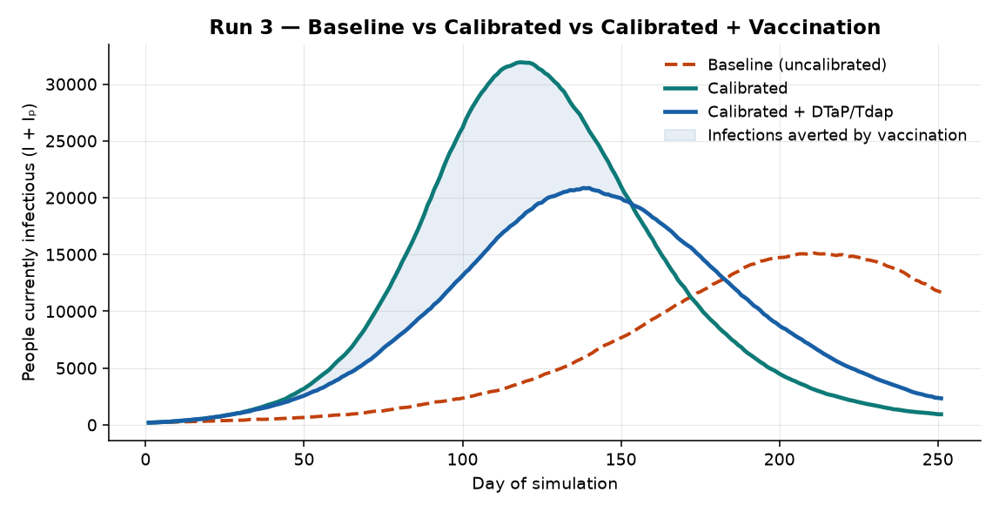
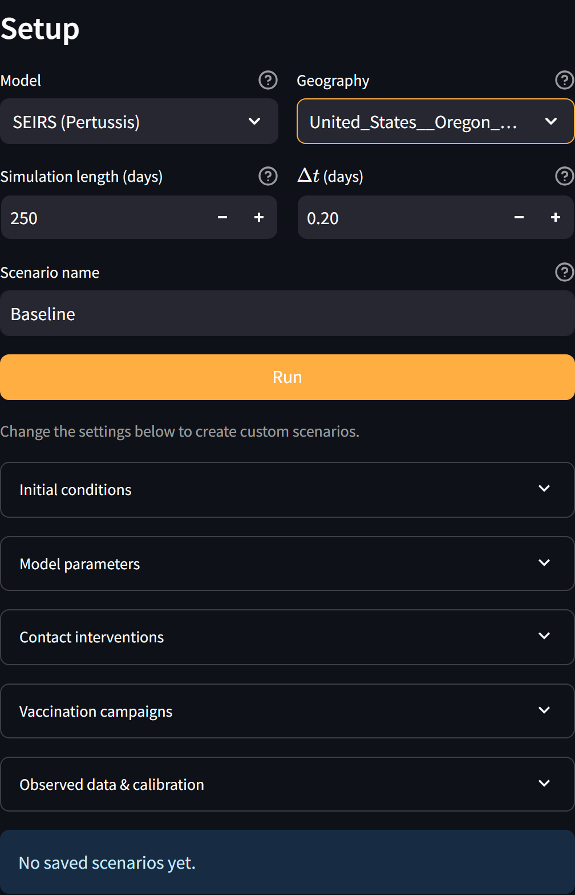
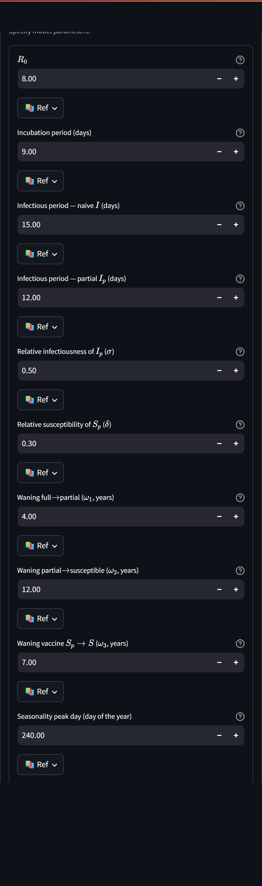
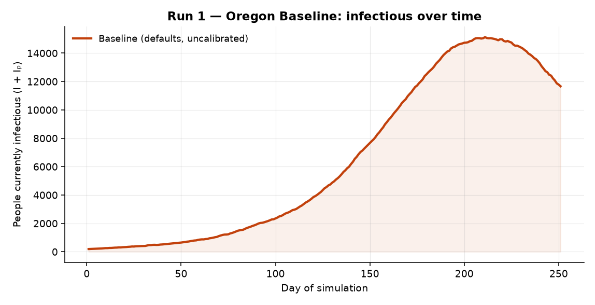
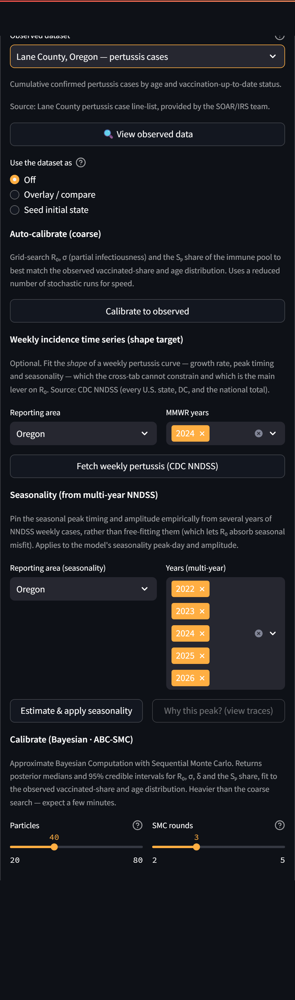
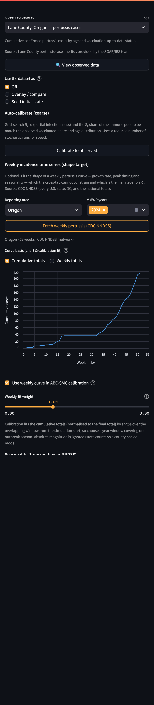
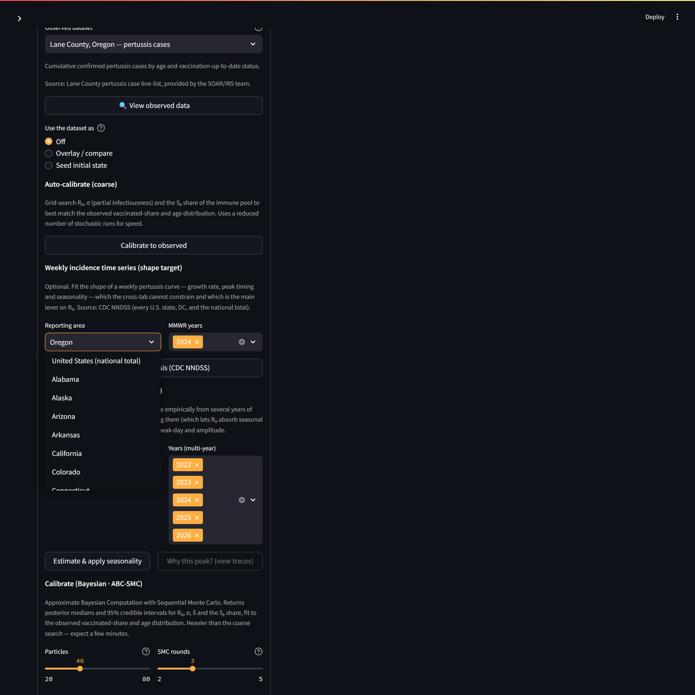
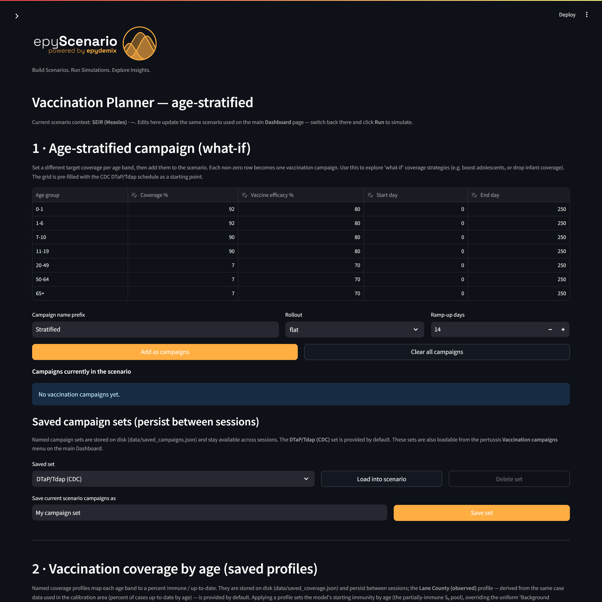

# EpyScenario User Manual — The Oregon Pertussis Thread

*An end-to-end worked example. Follow one Oregon scenario through three progressively more realistic runs and you will have used every core part of the tool: setup, calibration to real surveillance data, and vaccination planning.*

> ℹ️ **Who this is for**  
> A public-health analyst who is comfortable with surveillance data but **new to simulation modeling**. No modeling background is assumed — each modeling idea is explained the first time it appears. If a term is unfamiliar, check the Glossary at the end.  

**The running example:** pertussis (whooping cough) in **Lane County, Oregon** (modeled population ≈ 381,181), calibrated to Lane County's age breakdown and Oregon's statewide CDC NNDSS weekly case curve. Every figure in this manual was produced by the steps it describes.

## What you will build

| Run | What you do | What you learn |
| --- | --- | --- |
| **1 · Baseline** | Run with default settings, no tuning | How to set up and run a scenario; what an *uncalibrated* result means |
| **2 · Calibrated** | Fit the model to Lane County + Oregon NNDSS data with ABC-SMC | How to anchor the model to reality and read the result |
| **3 · + Vaccination** | Add the CDC DTaP/Tdap schedule | How an immunization program changes the outlook |

*The destination: all three runs on one axis — infectious people over time. Baseline (uncalibrated), calibrated to Oregon data, and calibrated with the DTaP/Tdap schedule added. You will reproduce each curve in turn.*

---

## 0 · Before you begin: orientation

EpyScenario is a **compartmental simulator**. Instead of tracking individual people, it divides the population into groups ("compartments") — susceptible, exposed, infectious, recovered — and moves people between them over time using rates you control. For pertussis there are two parallel tracks (fully susceptible people and partially-immune people whose protection has waned); the [compartmental-model diagram](https://claude.ai/artifact/AERBNM59DqzeK46GHR4XZx) shows the full structure. You do **not** need to understand the math to use the tool.

1. Start the app with **run_dashboard.ps1**. Your browser opens to the Dashboard at `http://localhost:8501`.
2. The screen has two halves: the **Setup panel** on the left (what you configure) and the **Visualization panel** on the right (results after you run).
3. Extra pages — **Vaccination Planner**, **Model References**, **Background** — are in the left sidebar (top-left ›).

*The Setup panel. You choose the disease **Model** and the **Geography** at the top, then expand the sections below to adjust detail. This manual's example uses **SEIRS (Pertussis)** and **Lane County, Oregon**.*

---

## Run 1 · Oregon Baseline (defaults, uncalibrated)

**Goal:** get your first curve with zero tuning, and understand exactly what that curve does — and does not — tell you.

### Steps

1. In the Setup panel, set **Model** to **SEIRS (Pertussis)**.
2. Set **Geography** to **Lane County, Oregon** (type "Lane" to filter the list).
3. Leave everything else at its default. The defaults are literature-based starting values — see the [parameter provenance document](../parameter-references.md) for the source of each.
4. Scroll down and click **Run**. After a few seconds the right panel fills with results.

*The **Model parameters** section (expanded). Every field has a **?** tooltip explaining what it means and why the default was chosen, plus a **📚 Ref** popover with citations. Leave these alone for Run 1.*

### The result

*Run 1 — baseline infectious curve. The model predicts a peak of roughly 15,129 people infectious at once, around day 211 of the simulation. This is the count of people in the infectious compartments (I + Iₚ) on each day.*

*The same run inside the app's Visualization panel. The **Compartment** selector defaults to **I** (the naïve infectious track only, peaking here around 7,000). The summary figures in this manual sum **both** infectious compartments — I + Iₚ (naïve + partial-track) — which is why their totals are higher (~15,129). Switch the selector to compare tracks; the tabs above the chart hold summary metrics, population structure, and (after Run 2) observed-vs-modeled.*

> ⚠️ **What "uncalibrated" means — read this before trusting the shape**  
> This curve uses generic literature values, **not** anything specific to Oregon. Treat it as *"what pertussis looks like in the abstract,"* not a forecast for Lane County. The peak height in particular is not meaningful yet — that is what Run 2 fixes. Uncalibrated runs are for sanity-checking the setup and exploring behavior, not for briefing decision-makers.  

---

## Run 2 · Oregon Calibrated (Lane County + Oregon NNDSS, ABC-SMC)

**Goal:** anchor the model to Oregon reality. "Calibration" means automatically searching for the parameter values that make the model best match observed data. EpyScenario uses **ABC-SMC** (Approximate Bayesian Computation — Sequential Monte Carlo), which returns not a single best guess but a *range* for each parameter, so you can see how certain the fit is.

> ℹ️ **Two data targets, two different jobs**  
> You attach **two** observed targets and each constrains something different:  
> • **Lane County age breakdown** — *who* gets pertussis (the split across age bands). This pins down the immunity/susceptibility parameters.  
> • **Oregon NNDSS weekly curve** — the *shape and timing* of the outbreak (how fast it grows, when it peaks). This is the main lever on R₀ (how transmissible the model thinks pertussis is).  

### Steps

1. Expand **Observed data & calibration** in the Setup panel.
2. Under **Observed dataset**, choose **Lane County, Oregon — pertussis cases**. This is the age cross-tab the calibrator will fit.
3. Under **Reporting area** (weekly curve), confirm **Oregon** and **MMWR years = 2024**, then click **Fetch weekly pertussis (CDC NNDSS)**. A weekly-case chart appears.
4. Tick **Use weekly curve in ABC-SMC calibration** so the timing target is included.
5. Under **Calibrate (Bayesian · ABC-SMC)**, set **Particles = 40** and **SMC rounds = 3** (good defaults: more of either = tighter fit but longer runtime).
6. Click **Run ABC-SMC calibration** and wait — a progress bar tracks the rounds (expect a few minutes). When it finishes, the fitted values are applied to the model.
7. Click **Run** on the Dashboard to simulate with the calibrated values.

*Selecting the Lane County observed dataset. The panel shows the raw age breakdown and how it maps onto the model's seven age bands.*

*After fetching, the Oregon NNDSS weekly curve is plotted and the **Use weekly curve in ABC-SMC calibration** checkbox appears. Calibration fits the *shape* of this curve, not its absolute counts.*

*The ABC-SMC controls. Particles = how many parameter combinations are kept each round; SMC rounds = how many times the search refines toward a tighter fit.*

### The two curves

*Run 2 — the baseline (dashed) versus the calibrated curve (solid teal). Calibrating to Oregon data shifts the peak to about 31,919 infectious around day 118 — a 111% increase versus the uncalibrated peak. This is the single most important comparison in the manual: it shows what anchoring to real data does to the answer.*

### Reading the posterior

ABC-SMC reports a **median** and a **95% credible interval (CrI)** for each fitted parameter — the interval is the range the data support. A narrow interval means the data pin that parameter down well; a wide one means it remains uncertain.

*Run 2 — the fitted posterior. Each dot is the median; the whiskers are the 95% credible interval; the grey bar is the prior range the search was allowed to explore. Parameters whose whiskers are much narrower than the grey bar are the ones the Oregon data constrained most.*

| Parameter | Calibrated median | 95% credible interval |
| --- | --- | --- |
| R₀ | 15 | 12 – 18 |
| σ (partial infectiousness) | 0.25 | 0.081 – 0.39 |
| δ (partial susceptibility) | 0.5 | 0.24 – 0.59 |
| Sₚ share of immune pool (%) | 61% | 43% – 89% |

> ⚠️ **Pertussis is heavily under-reported**  
> Confirmed pertussis counts capture only a fraction of true infections (often 1 in 10 or fewer, and it varies by age). That is why calibration here fits the **shape** of the weekly curve, not its absolute height — and why you should read the calibrated peak as a modeled quantity, not a promised case count.  

---

## Run 3 · Calibrated + DTaP/Tdap Vaccination

**Goal:** keep the calibrated model from Run 2 and layer on a realistic immunization program to see its effect.

> ℹ️ **How pertussis vaccination is modeled**  
> The DTaP/Tdap vaccine is **not** sterilizing and its protection **wanes**. So in the model, vaccinating someone does not remove them from circulation — it moves them from *fully susceptible* (S) into the *partially-immune* track (Sₚ), where they are less likely to be infected and less infectious if they are. This is the vaccination arrow in the model diagram.  

### Steps

1. Open **Vaccination Planner** from the sidebar.
2. In **section 1 · Age-stratified campaign**, the grid is **pre-filled with the CDC DTaP/Tdap schedule** (infants/children ≈ 92%, adolescents ≈ 90%, adults ≈ 7%). You can accept it as-is for this example.
3. Click **Add these campaigns to the scenario**.
4. Return to the **Dashboard** (sidebar) — your Run 2 calibration is still active — and click **Run**.

*The Vaccination Planner. The campaign grid comes pre-filled with the CDC DTaP/Tdap coverage by age band, so a realistic schedule is one click away.*

### The three-way comparison

*Run 3 — baseline, calibrated, and calibrated-plus-vaccination together. Adding the DTaP/Tdap schedule lowers the calibrated peak from about 31,919 to 20,851 infectious — roughly a 35% reduction — and the shaded band is the infections averted over the 250-day horizon.*

> 💡 **This is the payoff of the whole thread**  
> Only because Run 2 anchored the model to Oregon data is this vaccination comparison meaningful. Running vaccination on top of the *uncalibrated* model would have compared two abstractions. Calibrate first, then intervene.  

---

## Interpreting results responsibly

- **Under-reporting:** modeled infections far exceed confirmed case counts. Compare *shapes and relative changes*, not absolute case numbers.
- **Uncalibrated ≠ forecast:** a run with default parameters shows generic behavior, not an Oregon-specific prediction.
- **Single-season horizon:** this example runs 250 days. The model has no births or aging between age bands, so it is not built for the multi-year birth-cohort cycles that drive long-run pertussis dynamics. Keep horizons to an outbreak/season scale.
- **Calibration gives ranges, not certainties:** read the 95% credible intervals; a wide interval means "the data don't pin this down."

## Glossary

| Term | Plain-English meaning |
| --- | --- |
| Compartment | A group the population is divided into (e.g. Infectious). People move between compartments over time. |
| SEIRS | Susceptible → Exposed → Infectious → Recovered → (back to) Susceptible as immunity wanes. |
| Partial-immunity track (Sₚ,Eₚ,Iₚ,Rₚ) | A parallel set of compartments for people with waned/partial protection — milder, less transmissible infections. |
| R₀ | Basic reproduction number: average people one case infects in a fully susceptible population. Main driver of how explosive an outbreak is. |
| Calibration | Automatically tuning parameters so the model matches observed data. |
| ABC-SMC | The Bayesian calibration method used here. Returns a range (posterior) for each parameter, not just one value. |
| Posterior / credible interval | The set of parameter values consistent with the data; the 95% CrI is where the truth most plausibly lies. |
| NNDSS | CDC's National Notifiable Diseases Surveillance System — the weekly case source used as the timing target. |

## Troubleshooting

| Symptom | Fix |
| --- | --- |
| "Fetch weekly" returns nothing | The app falls back to a local cache; if a year has no data, pick another MMWR year (2024 is used here). |
| ABC-SMC is slow | Lower Particles or SMC rounds; both trade fit quality for speed. A few minutes at 40×3 is normal. |
| Calibration "won't converge" / too few accepted | The tolerance may be too tight for the priors — reduce rounds, or widen the run horizon so the weekly window overlaps the data. |
| Empty result chart | Make sure you clicked **Run** on the Dashboard after calibrating or editing the vaccination plan. |

## Appendix · where things live

- **Parameter sources:** [docs/parameter-references.md](../parameter-references.md) and the in-app **Model References** page (portable provenance HTML).
- **Tactical "how to derive from your own data" recipes:** [docs/tactical.txt](../tactical.txt).
- **Model structure & equations:** the [compartmental-model diagram](https://claude.ai/artifact/AERBNM59DqzeK46GHR4XZx) and [docs/pertussis-model-structure.md](../pertussis-model-structure.md).
- **Reproduce the figures:** the scenarios in this manual were generated headlessly with the same engine the app uses (geography United States  Oregon  Lane County, 52-week Oregon NNDSS target).
