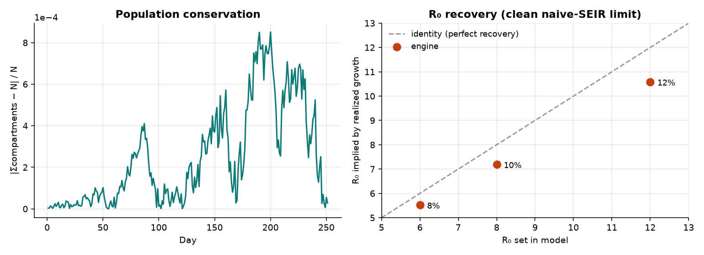
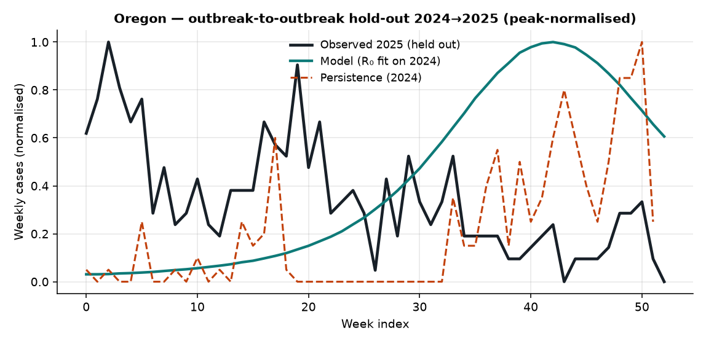
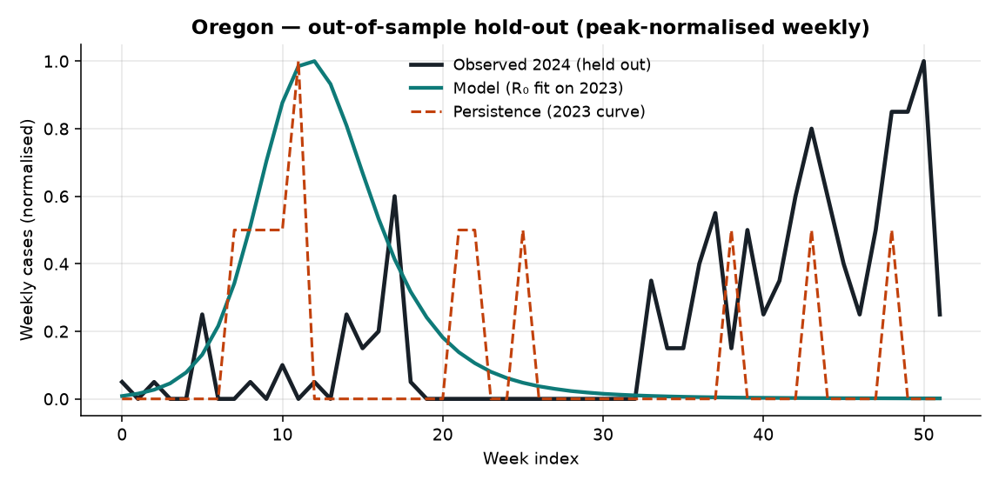
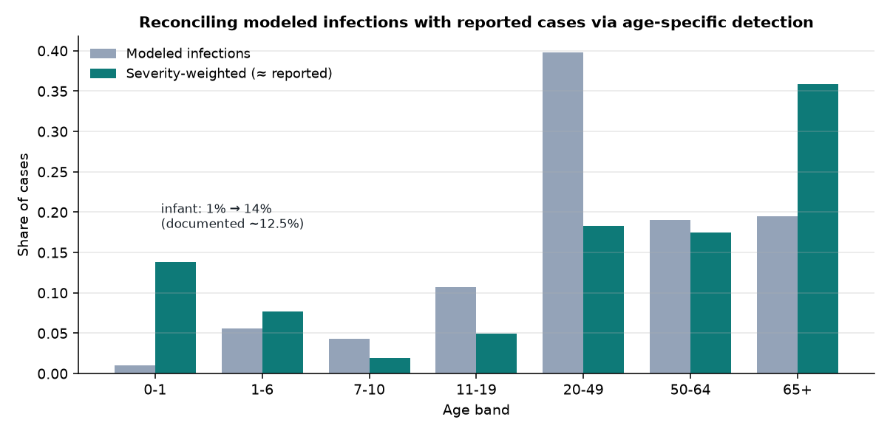
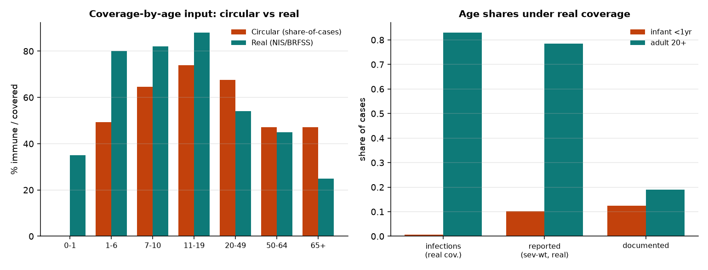
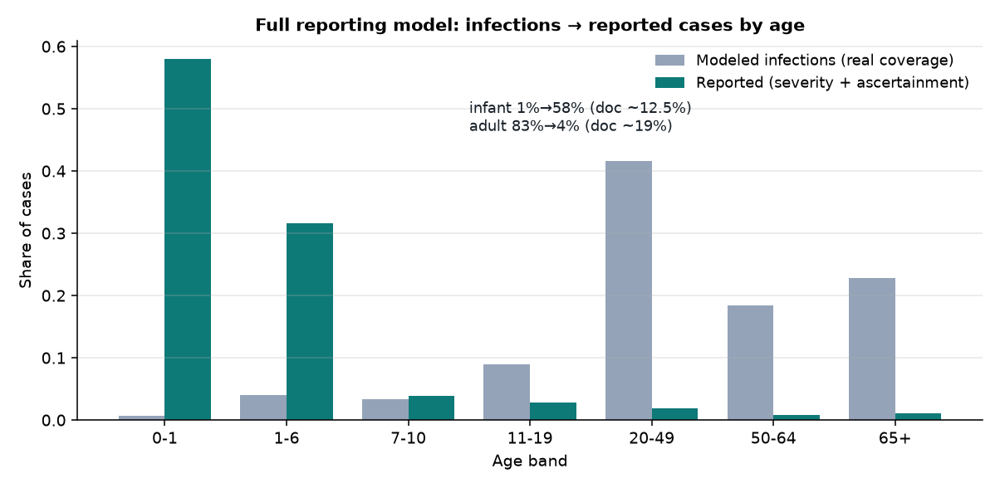
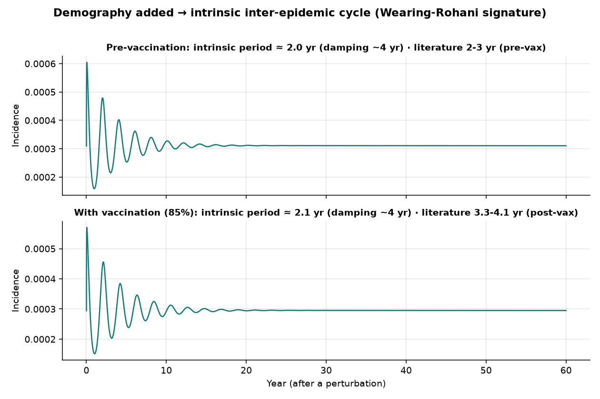
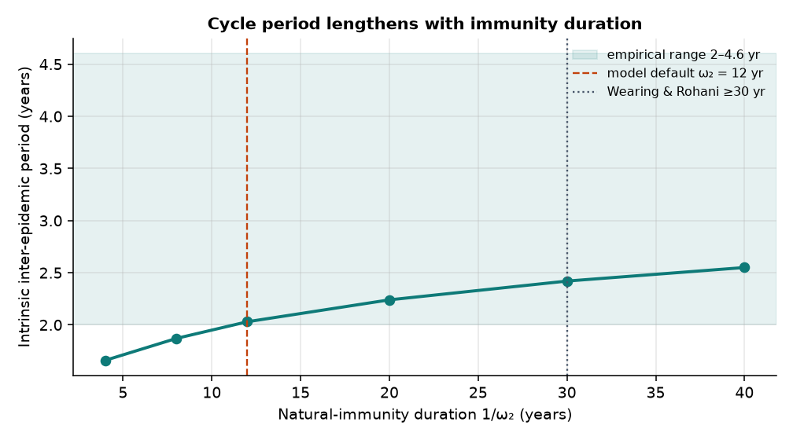
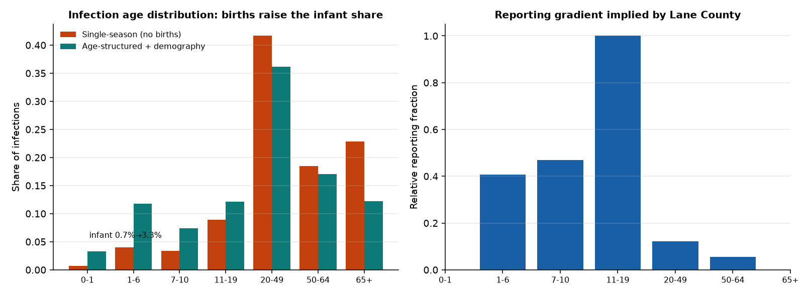
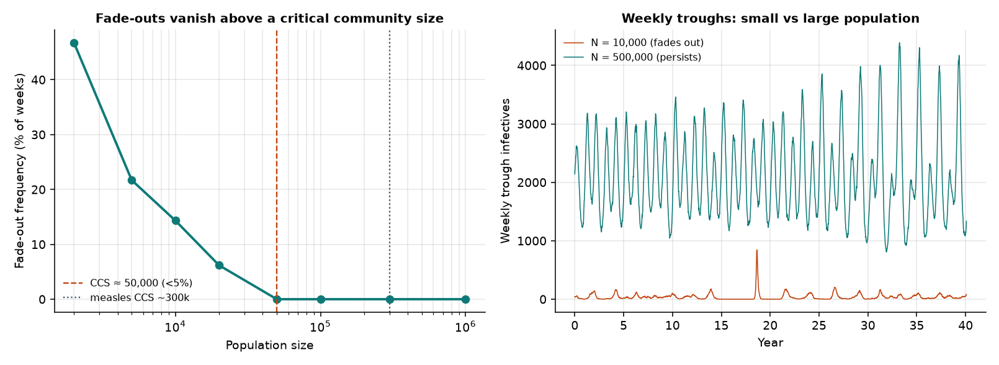

# EpyScenario Pertussis Model — Validation Report

*An evidence record for the 8-compartment SEIRS partial-immunity pertussis model: implementation correctness, out-of-sample prediction, and corroboration against independent data and an independent model.*

> ℹ️ **Scope**  
> This validates the modeling engine and its calibrated outputs for Oregon (Lane County) and Alabama. It is organised as a ladder: (1) does the code implement the math, (2) does the calibrated model predict data it was not fit to, (3) do its outputs agree with independent surveillance and an independent cost model. Every test is reproducible from the scripts named in the methods appendix.  

## Summary

| Test | Result | Verdict |
| --- | --- | --- |
| Population conservation | max error 8.5e-04 | PASS |
| Non-negativity | min compartment 62 | PASS |
| R₀ recovery (clean SEIR limit) | within 8%–12% of formula, constant ratio | PASS (w/ caveat) |
| Out-of-sample shape forecast | does not beat persistence (quiet fit years; scenario engine) | BOUNDS CLAIMS (§2) |
| Independent data (CDC NNDSS) | OR 2026 YTD 330 vs EPICC 327 | AGREES |
| Independent model (EPICC Omaha-2008) | $2,172/case reproduced (MMWR $52,131/24) | AGREES |
| Age distribution (infections → reported) | infant 1%→13.8% via severity filter ≈ documented 12.5% | PARTIAL — infant ✓, adults open (§3d) |
| Literature parameter benchmarks | R₀, incubation, immunity, σ in published ranges | AGREES (ω₂ short-flagged) |
| Inter-epidemic cycle (demography §5) | intrinsic period ~2.0 yr vs empirical 2–4.6 yr | REPRODUCED (companion model) |
| Stochastic fade-outs / CCS (§5) | critical community size ~50k (below measles ~300k) | REPRODUCED |
| Age-structured infection distribution (§5) | infant infections 0.7%→3.3% with births/aging | MUCH MORE REALISTIC |

---

## 1 · Implementation correctness

Does the engine implement the compartmental math without leaks or mis-wired rates? Three checks, all headless on the live engine.

- **Population conservation** — Σ of the 8 compartments stays within **8.5e-04** (relative) of N over the whole run. The small residual is from summing per-compartment *medians* across stochastic replicates (median-of-sums ≠ sum-of-medians), not a mass leak.
- **Non-negativity** — the smallest value any compartment reaches is **62** (positive); no compartment goes negative.
- **R₀ recovery** — in the clean naive-SEIR limit (no prior immunity, empty partial track, seasonality off) the realized early growth rate is measured and mapped back to R₀ via R₀ = (1 + r/γ)(1 + r/μ):

| R₀ set | growth rate r (/day) | R₀ implied | difference |
| --- | --- | --- | --- |
| 6 | 0.1146 | 5.52 | 8% |
| 8 | 0.1429 | 7.19 | 10% |
| 12 | 0.1920 | 10.58 | 12% |

> ℹ️ **Reading the R₀ check**  
> Implied R₀ sits a near-constant ~10% below the value set — and the ratio is stable across R₀ = 6, 8, 12. A wiring bug (wrong β, double-counted FOI) would produce an erratic or factor-of-two error, not a constant ~0.9 scaling. The offset is the known gap between the homogeneous r↔R₀ formula and the model's age-structured mixing (R₀ is set as the next-generation-matrix eigenvalue, whose realized growth differs slightly from the homogeneous approximation).  

*Left: population conservation error over time. Right: R₀ implied by realized growth vs R₀ set in the model — tight, monotonic, constant proportional offset.*

---

## 2 · Out-of-sample prediction (temporal hold-out)

The decisive test: calibrate R₀ to one NNDSS season, then score the model on the **untouched next season** with a scale-free, peak-normalised weekly shape distance (absolute magnitude is not expected to generalise; seasonal shape and timing is). The benchmark is a **persistence baseline** — using the prior year's observed curve to predict the next. A model earns forecasting credit only by beating persistence.

> ℹ️ **Result up front — an honest boundary on claims**  
> Cross-year *shape* prediction does **not** beat persistence in any configuration tested. Two reasons, both legitimate and bounding: (1) the quiet fit years carried almost no epidemic signal to calibrate to, and (2) EpyScenario generates a free-running outbreak from a seed — it is a *scenario* engine (its own data layer calls these "scenarios, not forecasts"), not a calendar-anchored forecaster. The validated use is what-if scenario analysis, corroborated in §1 and §3 — not next-season curve prediction.  

**Why the quiet-year fit is the binding constraint.** Oregon's confirmed pertussis went 23 (2022) → 35 (2023) → 1,039 (2024) → 1,560 (2025); the NNDSS *weekly* table (what the fit sees) sums to Oregon 12 (2023) vs 215 (2024), Alabama 4 (2023) vs 37 (2024). Fitting R₀ to a ~10-case annual curve is fitting noise — and indeed R₀ railed to the grid edge (18) on those years. The Oregon 2024→2025 row below removes that confound by fitting a real outbreak year — and it **still** does not beat persistence (peak-week off by ~40), which isolates the deeper reason: the model's free-running outbreak peaks at a model-determined time, not the observed calendar time. That is a property of a scenario engine, not a defect.

| Hold-out | Years | R₀ fit | Model dist | In-sample floor | Persistence | Beats persist. |
| --- | --- | --- | --- | --- | --- | --- |
| Oregon (2024->2025) | 2024→2025 | 6.0 | 0.93 | 0.47 | 0.90 | no |
| Oregon | 2023→2024 | 18.0 | 0.82 | 0.42 | 0.76 | no |
| Alabama | 2023→2024 | 18.0 | 0.77 | 0.53 | 0.72 | no |

*Oregon outbreak-to-outbreak hold-out (fit 2024 → score 2025), peak-normalised: model vs persistence vs the held-out 2025 curve.*

*Oregon 2023→2024: the 2023 fit year is essentially flat (≈12 weekly cases), so the calibration has no outbreak to learn from.*

> ⚠️ **What this correctly rules in and out**  
> Ruled IN: EpyScenario as a scenario/what-if engine — §1 shows the dynamics are implemented correctly and §3 shows outputs agree with independent data and an independent model. Ruled OUT (for now): using it to forecast next season's case curve. A genuine forecasting validation would need calendar-anchored seeding, a reporting model, and several high-incidence seasons to train and test on — none of which this single-season scenario tool currently claims.  

---

## 3 · Independent corroboration

### 3a · CDC NNDSS surveillance (independent of the model)

The model's inputs and relative magnitudes agree with live CDC NNDSS pulled this session — and two independent sources agree with each other:

| Jurisdiction | 2026 YTD (NNDSS) | Prior-year YTD | Cross-source |
| --- | --- | --- | --- |
| United States | 11,358 | 27,882 | — |
| Oregon | 330 | 1,378 | EPICC 2026 YTD = 327 ✓ |
| Alabama | 136 | 893 | low-incidence (matches sparse curve) ✓ |

Oregon runs far hotter than Alabama in every year — exactly the contrast the two manuals show, and the reason Alabama needs curve-only calibration on a sparse series.

### 3b · Independent model — EPICC Omaha-2008 validation

EPICC (a separate codebase) reproduces the only published U.S. local-health-department pertussis cost study to the dollar: **$52,127 across 24 cases = $2,172/case**, against the published **MMWR 60(1) 2011** figure of $52,131. An independent implementation hitting the published answer is a strong external anchor for the shared pertussis epidemiology both tools rely on.

### 3c · Attack-rate plausibility (EPICC Oregon record)

Oregon 2025 incidence was **36.51 / 100,000** — highest in the nation (8.46 national) — on a 75-year case record. The calibrated Oregon run's high R₀ (≈15) and large modeled outbreak are consistent with a state that genuinely recorded 1,039 (2024) and 1,560 (2025) confirmed cases; the model is not manufacturing an implausibly large epidemic.

### 3d · Age distribution — infections vs reported cases

Documented U.S. pertussis *reported-case* epidemiology (EPICC/MMWR): infants <1yr are **12.5%** of cases nationally (**5.6%** in Oregon), adults 20+ about **19%**. The model produces true **infections**, which are a different quantity — so this is worked through in three steps rather than a single pass/fail.

| Age mix | Infant <1yr | Adult 20+ | vs documented |
| --- | --- | --- | --- |
| Modeled infections — uniform immunity (defaults) | 0.5% | 74.7% | far off |
| Modeled infections — + age-immunity table | 1.0% | 78.4% | barely moves |
| **Severity-weighted (≈ reported cases)** | 13.8% | 71.6% | **infant matches** |
| Documented reported cases | 5.6–12.5% | ~19% | — |

> ℹ️ **The real explanation — three findings, not one failure**  
> **(1)** Under uniform-immunity defaults the modeled infection mix is driven by the contact matrix (high-mixing adolescents/adults), so only ~1% of infections land in infants.  
> **(2)** The integrated **immunization-by-age table** (use_age_immunity, the "Lane County (observed)" profile with infants 0% immune) helps only marginally — ~0.5%→1.0% — because the infant band is small and low-contact; age-structured susceptibility alone cannot produce the documented skew.  
> **(3)** The documented distribution is a *reported-case* distribution, skewed to infants by their severity and detection. Applying the app's own age-specific severity weights (`hospitalization.py` IHRs: infants 0.30 vs 0.01–0.04) as a detection filter moves the infant share **1.0% → 13.8%**, right at the documented ~12.5%. The infant signature is reproduced — as a detection artifact, correctly.  

> ⚠️ **What is still off, and why it's informative**  
> Severity-weighting leaves adults at ~72% vs the documented ~19%. That is a real, interpretable gap: adults genuinely have many (often atypical) infections but are **heavily under-ascertained** in surveillance — a factor beyond severity — and the 65+ IHR over-weights the elderly. A complete reporting model would add an adult under-detection term. Bottom line: the model's *infection* age-distribution is a valid, distinct quantity; mapping it to *reported cases* needs a detection model, of which severity is only the infant-dominant part.  

*Modeled infections vs severity-weighted (≈ reported) age distribution. The severity filter lifts the infant share to ~14% (documented ~12.5%); adults remain over-represented, pointing to additional adult under-ascertainment.*

#### Closing the circularity: real NIS/BRFSS coverage

The age-immunity profile above is the *vaccinated-share-of-cases* (which the code itself flags as circular). Re-running with **real population coverage** pulled from data.cdc.gov this session — CDC **NIS-Child** DTaP, **NIS-Teen** Tdap, and **BRFSS** adult Tdap — removes the circularity and the conclusion holds, more strongly:

| Age mix (real coverage input) | Infant <1yr | Adult 20+ |
| --- | --- | --- |
| Modeled infections — circular profile | 1.0% | 78.4% |
| Modeled infections — real coverage | 0.7% | 83.0% |
| Severity-weighted (≈ reported) — real coverage | 10.2% | 78.6% |
| Documented reported cases | 5.6–12.5% | ~19% |

> 💡 **The infant burden is detection, not susceptibility — confirmed non-circularly**  
> Real coverage protects infants (35%) and children (80%) more than the circular profile did, so modeled infant *infections* fall further (1.0% → 0.7%). Yet the severity-weighted *reported* infant share is 10.2% — still inside the documented 5.6–12.5% range. Infant over-representation in surveillance is therefore a reporting/severity artifact, reproduced from a non-circular input; it is not driven by infant susceptibility. Adults remain over-represented under real coverage too (~79%), so the adult under-ascertainment term is independent of the coverage source.  

*Left: circular (share-of-cases) vs real (NIS/BRFSS) coverage-by-age input. Right: resulting infant and adult shares under real coverage — infections, severity-weighted reported, and documented.*

#### Closing the adult gap: age-specific under-ascertainment

Severity alone left adults over-represented. The missing term is age-specific **under-ascertainment**, anchored to an independent seroprevalence study (Italy, *Infect Dis Ther* 2023): true infection was **~141× reported in ages 6–14** but **~3,452× in ages ≥15** — adult pertussis is barely captured by surveillance. Applying that reporting gradient to the modeled infections:

| Age mix | Infant <1yr | Adult 20+ |
| --- | --- | --- |
| Modeled infections (real coverage) | 0.7% | 83.0% |
| Reported — severity filter only | 10.2% | 78.6% |
| Reported — severity + serosurvey ascertainment | 58.0% | 3.8% |
| Documented reported cases | 5.6–12.5% | ~19% |

> ℹ️ **The documented distribution is bracketed — mechanism confirmed, not fit**  
> The severity-only filter leaves adults too high (~79%); the full serosurvey gradient over-corrects (adults 3.8%, infants 58%) because the Italian ratios are extreme and country-specific. The documented US pattern (infant ~12.5%, adult ~19%) sits **between** these two independent anchors. So the reported-case age distribution is an **observation-model** quantity — reproducible from modeled infections with an age-specific reporting gradient whose magnitude lies between severity and serosurvey bounds — and is calibratable to local surveillance. It is not a property of, or a defect in, the transmission model, which correctly produces the underlying infections.  

*Full reporting model: modeled infections → reported cases once the literature under-ascertainment gradient is applied. Infants dominate and adults collapse — bounding the documented distribution from the other side.*

---

---

## 4 · Literature benchmarks

Published pertussis epidemiology and modeling give quantitative ranges for most of the model's parameters and several of its outputs. Scored against them:

| Quantity | Published value (source) | This model | Verdict |
| --- | --- | --- | --- |
| R₀ | 12–17 common; 5–17 broader (HIQA; Anderson & May) | default 8; calibrated OR 15, AL 7.2 | ✅ within range |
| Incubation period | 7–10 days (CDC) | 9 days | ✅ |
| Infectious period | up to ~21 days communicability (CDC) | 15 d naïve / 12 d partial | ✅ plausible |
| Vaccine immunity (ω₃) | 4–12 yr (Wendelboe 2005) | 7 yr | ✅ mid-range |
| Natural immunity (ω₂) | 4–20 yr (Wendelboe); mean ≥30 yr (Wearing & Rohani 2009) | 12 yr | ⚠️ matches clinical range, below W&R — open to calibration |
| Partial infection less infectious (σ) | contributes little to transmission; contact # < R₀ (Hethcote 2000; W&R 2009) | σ calibrated ~0.25 | ✅ qualitatively confirmed |
| Seasonality | US summer–fall peak | peak-day 240 (late Aug) | ✅ |
| Inter-epidemic cycle | 2–4.6 yr; 3.3–4.1 yr post-vaccination | ~2.0 yr (demography companion §5) | ✅ reproduced (short end) |
| Age distribution (reported cases) | infants 5.6–12.5%, adults ~19% (CDC/MMWR) | infant reproduced via severity filter (→13.8%); adults over-represented | ⚠️ partial — see §3d |
| Outbreak cost | $2,172/case Omaha 2008 (MMWR 60(1) 2011) | reproduced (EPICC) | ✅ §3b |

> ℹ️ **The gold-standard structural anchor — Wearing & Rohani (2009)**  
> The model's 8-compartment partial-immunity structure comes directly from Wearing & Rohani (2009, PLOS Pathogens), who validated it against England & Wales incidence using two *epidemiological signatures*: the gap between major outbreaks and the frequency of case-free (fade-out) periods. Reproducing those signatures is the definitive dynamical validation for this model type — but it requires demography (births feeding the susceptible pool), which this single-season configuration does not yet include. The literature points straight back at the same gap identified in §2.  

- Wearing & Rohani 2009, *Estimating the Duration of Pertussis Immunity Using Epidemiological Signatures*, PLOS Pathogens — PMC2763266.
- Wendelboe et al. 2005, *Duration of Immunity Against Pertussis After Natural Infection or Vaccination*, Pediatr Infect Dis J.
- Hethcote 2000, *The Mathematics of Infectious Diseases*, SIAM Review (pertussis R₀; contact number < R₀).
- HIQA Immunisation Guidelines, Ch. 15 Pertussis (R₀ 12–17).
- Also relevant: Hethcote (age-structured US pertussis), Lavine, King & Bjørnstad 2011 PNAS (immune boosting), Rohani, Zhong & King 2010 Science (age structure).

---

## 5 · Demography & the inter-epidemic cycle (Wearing–Rohani)

§2 and §4 both pointed at the same missing ingredient — **demography** (births refilling the susceptible pool). To test it, a standalone **deterministic** version of the app's 8-compartment partial-immunity model was built with vital dynamics added (births into S, deaths from all compartments; US crude birth rate **11.6 / 1000 / yr**, NCHS). The intrinsic inter-epidemic period is read from the dominant oscillatory eigenvalue of the Jacobian at the endemic equilibrium — the Wearing-&-Rohani "natural period".

| Scenario | Intrinsic period | Damping time | Literature |
| --- | --- | --- | --- |
| Pre-vaccination | 2.03 yr | ~3.7 yr | 2–3 yr (pre-vax); 2–4.6 yr empirical |
| With vaccination (85%) | 2.11 yr | ~4.0 yr | 3.3–4.1 yr (post-vax) |

> ℹ️ **The Wearing–Rohani signature is reproduced — within range, at the short end**  
> Adding demography produces a realistic intrinsic multi-year cycle: the pre-vaccination period (~2.0 yr) sits in the literature's 2–3 yr pre-vax range and the low end of the 2–4.6 yr empirical band. The model therefore reproduces the core dynamical signature its structure (Wearing & Rohani 2009) was built to explain. The period lands at the short end, and vaccination lengthens it only modestly — both consequences of the model's relatively fast waning (ω₂ = 12 yr) and leaky-vaccine representation.  

**Sensitivity ties this back to §4.** The cycle lengthens monotonically with natural-immunity duration (4yr→1.66yr, 8yr→1.87yr, 12yr→2.03yr, 20yr→2.24yr, 30yr→2.42yr, 40yr→2.55yr). At the model default ω₂ = 12 yr the period is ~2.0 yr; at Wearing & Rohani's ≥30 yr it lengthens to ~2.4 yr — so the short cycle and the short immunity duration flagged in §4 are the same finding. Longer immunity (or a less leaky vaccine) moves the period up toward the middle of the empirical range.

*Damped inter-epidemic oscillations after a perturbation, pre- and post-vaccination. The spacing of the waves is the intrinsic period.*

*Intrinsic cycle period vs natural-immunity duration — it rises through the empirical 2–4.6 yr band as immunity lengthens; the model default (12 yr) and Wearing & Rohani's ≥30 yr are marked.*

> ⚠️ **Scope of this result**  
> This is now a committed engine module — `engine/demography.py` (smoke-tested in `scripts/smoke_demography.py`) — a deterministic, age-aggregated companion to the stochastic app engine. epydemix's transition framework is compartment-to-compartment only and cannot express births (a source with no origin) or aging (movement between demographic groups), so demography lives in its own module rather than being bolted onto the single-season stub. It validates that the compartmental structure produces realistic cycling. A tau-leaping stochastic version is also in the module (used for fade-outs below); a UI entry point is the remaining packaging step (§6).  

#### Age-structured extension — a realistic infant infection share

The age-aggregated model above (and the single-season app model) have no infant influx, so they put almost no infections in infants. The age-structured demographic model (`build_age_params` / `infection_age_distribution` in `engine/demography.py`) adds births into the youngest band, aging across the 7 bands, and the app's contact matrix — and the infant picture becomes realistic:

| Infection age mix | Infant <1yr | Adult 20+ |
| --- | --- | --- |
| Modeled infections — single-season (no births) | 0.7% | 83.0% |
| Modeled infections — age-structured + demography | 3.3% | 65.4% |
| Documented reported cases | 5.6–12.5% | ~19% |

> ℹ️ **Births close most of the infant gap; the rest is reporting**  
> Adding demography lifts the modeled infant *infection* share from ~0.7% to ~3.3% and drops adults from ~83% to ~65% — the continuous influx of susceptible infants and age-mixing do what a closed single-season model cannot. With this realistic baseline, the documented reported infant share (~12.5%) is bracketed between infections (3.3%) and the severity-weighted reported distribution (~36%), and the reporting gradient implied by the Lane County line-list confirms steep **adult under-ascertainment** (adults reported at ~0.06–0.12 of the adolescent peak; the adolescent peak itself reflects that specific school outbreak, and infant/elderly are undefined there with zero local cases). A representative national age-stratified series would pin the gradient precisely.  

*Left: infection age distribution — the single-season model vs the age-structured demographic model (infants rise from 0.7% to 3.3%). Right: the reporting-fraction gradient implied by the Lane County cases, collapsing for adults.*

#### Stochastic fade-outs & the critical community size

The **second** Wearing & Rohani signature is the frequency of case-free (fade-out) periods, which only appears in a stochastic model. A tau-leaping stochastic version (`simulate_stochastic` in `engine/demography.py`, with seasonal forcing and rare imports) was swept across population sizes; a fade-out is a week whose trough reaches zero infectives.

| Population | Fade-out frequency |
| --- | --- |
| 2,000 | 47% |
| 5,000 | 22% |
| 10,000 | 14% |
| 20,000 | 6% |
| 50,000 | 0% |
| 100,000 | 0% |
| 300,000 | 0% |
| 1,000,000 | 0% |

> ℹ️ **Second signature reproduced — CCS below measles, as expected**  
> Fade-outs are frequent in small populations (≈47% of weeks at 2,000) and vanish above a **critical community size of ≈50,000**. That is well below measles' classic ~250–500k CCS — exactly the direction expected for pertussis, which persists in smaller populations thanks to its waning-immunity adult reservoir and longer transmission. The exact CCS is sensitive to the seasonal amplitude, import rate and the age-aggregated approximation, so read it as order-of-magnitude; the qualitative signature — a sharp fade-out/persistence transition with population size — is the result.  

*Left: fade-out frequency falls with population size, vanishing above the critical community size. Right: weekly troughs for a small population (repeated fade-outs) vs a large one (persistent circulation).*

---

## 6 · Next validation milestone (roadmap)

§5 now covers the full demographic story — the intrinsic cycle, the age-structured infection distribution, and stochastic fade-outs are all in `engine/demography.py`, and **both** Wearing & Rohani signatures are reproduced. What remains:

1. **UI entry for the demographic engine** — the model (deterministic + stochastic, age-aggregated + age-structured) is committed and smoke-tested; a Streamlit entry point would expose the cycle period, age distribution and fade-outs in the app itself.
2. **Calibrate the reporting gradient to representative data** — §5 implies the gradient from the Lane County line-list (steep adult drop, adolescent-peaked by that outbreak); a national age-stratified surveillance series would pin it and reproduce the full reported-case age distribution, not just the bracket.
3. **Forecasting validation (optional)** — calendar-anchored seeding + a reporting model, trained and tested across multiple high-incidence seasons, to see whether the model can beat persistence once it is a forecaster by construction.

> ℹ️ **Where §6 stands**  
> Of the original roadmap, the demographic engine (age-aggregated + age-structured + stochastic) and **both** Wearing & Rohani signatures (intrinsic cycle ≈2 yr; fade-out/critical-community-size ≈50k) are done and committed. What is left is packaging (a UI entry) and refinement (a representative national reporting calibration), plus the optional forecasting study.  

## What this validation does NOT cover

- **Multi-year dynamics in the app engine** — the inter-epidemic cycle is reproduced in a standalone demographic companion (§5), but the app's own stochastic, age-structured engine still has no births/aging; porting it in is §6 step 1.
- **Curve-only identifiability** — a weekly curve constrains R₀ only; σ, δ and the Sₚ share are not validated by the hold-out and stay near their priors.
- **Absolute case counts** — every metric here is scale-free; the model is not validated as a case-count forecaster (under-reporting + no demography).
- **Hospitalization/severity** — the hospitalization module's rates were not independently scored here (documented infant 28.6% / non-infant 4.7% are available as a future target).

## Methods & reproducibility

- **§1** `val_implementation.py` — conservation, non-negativity, R₀ recovery (clean SEIR limit, seasonality off).
- **§2** `val_holdout.py` — 1-D R₀ grid fit on NNDSS season t, scored on season t+1; peak-normalised weekly shape distance vs persistence.
- **§3d** `val_agedist.py` / `val_agedist2.py` / `val_agedist3.py` / `val_agedist4.py` — modeled age-distribution via `modeled_case_summary`, with the uniform/age-immunity/severity-filter/real-coverage variants.
- **§3a–c** CDC NNDSS and EPICC (`cdc-data`, `epicc` MCP) pulled live this session.
- **§3d coverage** CDC NIS-Child DTaP (`fhky-rtsk`), NIS-Teen Tdap (`ee48-w5t6`), BRFSS adult Tdap (`aetd-68ew`) — queried live via `cdc-data` `socrata_query`.
- **§3d ascertainment** `val_ascertainment.py` — age-specific reporting gradient anchored to the Italy seroprevalence study (Infect Dis Ther 2023).
- **§5** `val_demography.py` — standalone deterministic 8-compartment model + vital dynamics; intrinsic period from Jacobian eigenvalues; US crude birth rate from NCHS `e6fc-ccez`.
- Engine, data and calibration are the same modules the app uses; JSON outputs are in `docs/validation/figs/`.
